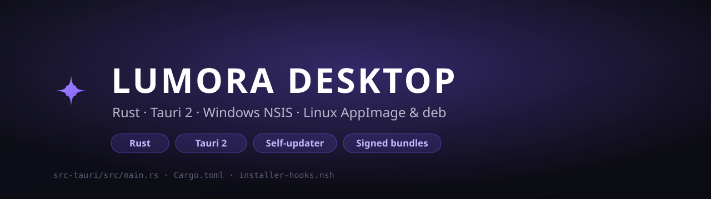

-7C5CFF)

A **production desktop application** built with **Rust + Tauri 2**. One Rust codebase
produces a **signed Windows installer (NSIS)** and **Linux packages (AppImage + .deb)**,
with a built-in **self-updater**.

> This repository showcases the **Rust / Tauri desktop layer**. The web frontend is a
> separate project; a small placeholder lives in `dist/` so this builds standalone.

---

## What I built

- **One Rust codebase → three native bundles** — Windows `nsis`, Linux `appimage`, Linux
  `deb`, all driven from a single `tauri.conf.json`.
- **Signed self-updater** — a `#[tauri::command]` checks a JSON manifest over HTTPS and
  **downloads + installs** new versions in the background (`tauri-plugin-updater` +
  a minisign keypair).
- **Professional installer UX** — a **branded NSIS installer** with custom pre/post
  install hooks (`installer-hooks.nsh`), header/sidebar artwork, LZMA compression, and a
  **bundled WebView2 bootstrapper** so it installs cleanly on a fresh Windows machine.
- **Tuned for size & speed** — release profile with `lto = true`, `codegen-units = 1`,
  `opt-level = "s"`, `strip = true`, `panic = "abort"`.
- **Capability-based security** — the app only gets the permissions declared in
  `capabilities/` (Tauri v2 model).

## Skills demonstrated

Rust · Tauri 2 · cross-platform packaging · NSIS scripting · code signing / secure
updates · desktop UX · build automation.

## Tech stack

Rust · Tauri 2 · `tauri-plugin-updater` · serde · NSIS · WebView2 · (frontend: Vite/React, separate)

## Project layout

```
src-tauri/
  src/main.rs            # Rust entry point + update command
  Cargo.toml             # dependencies + optimized release profile
  Cargo.lock
  build.rs
  tauri.conf.json        # window, bundle targets (nsis/appimage/deb), NSIS + updater config
  capabilities/default.json
  installer-hooks.nsh    # custom NSIS install / uninstall hooks
  installer.nsi
  icons/                 # app + installer artwork
dist/                    # tiny placeholder frontend (swap for your real web build)
package.json             # npm scripts that drive the Tauri CLI
assets/banner.svg
```

## Build

Prerequisites: **Rust** (MSVC toolchain on Windows), **Node.js 18+**, and **VS Build Tools**
(Windows).

```bash
npm install            # installs @tauri-apps/cli
npm run tauri:dev      # run the desktop app in dev
npm run tauri:build    # produce the native bundles
```

| Platform | Bundle |
|----------|--------|
| Windows  | `src-tauri/target/release/bundle/nsis/*-setup.exe` |
| Linux    | `src-tauri/target/release/bundle/appimage/*.AppImage`, `.../deb/*.deb` |

## The update command (excerpt)

```rust
#[tauri::command]
async fn check_update(app: tauri::AppHandle) -> Result<String, String> {
    let updater = app.updater().map_err(|e| e.to_string())?;
    let update = match updater.check().await {
        Ok(Some(u)) => u,
        Ok(None) => return Ok("up-to-date".into()),
        Err(e) => return Err(e.to_string()),
    };
    let version = update.version.to_string();
    tauri::async_runtime::spawn(async move {
        let _ = update.download_and_install(|_c, _t| {}, || {}).await;
    });
    Ok(format!("downloading:{}", version))
}
```

---

*Built by [mxgamecoder](https://github.com/mxgamecoder) — available for Rust / Tauri desktop work.*
